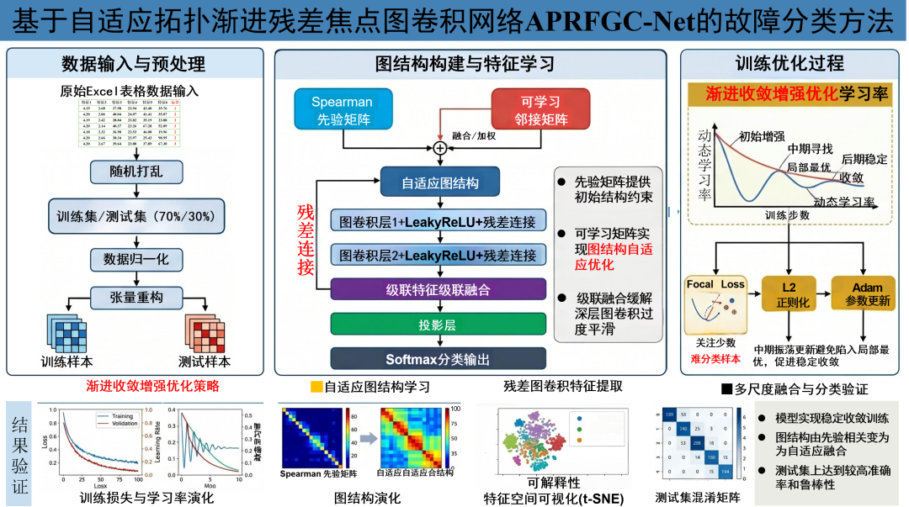
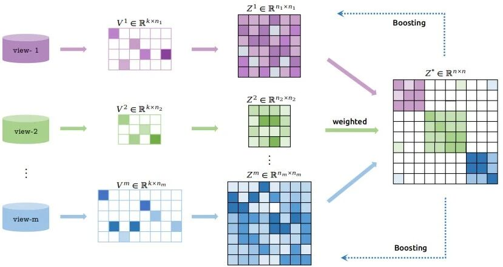
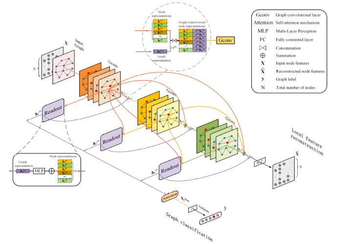
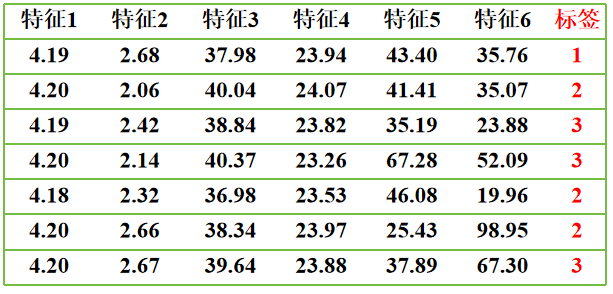
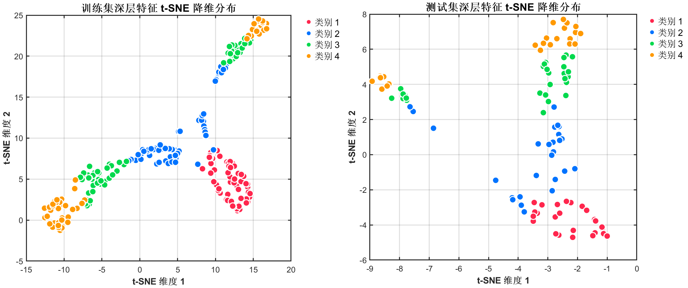
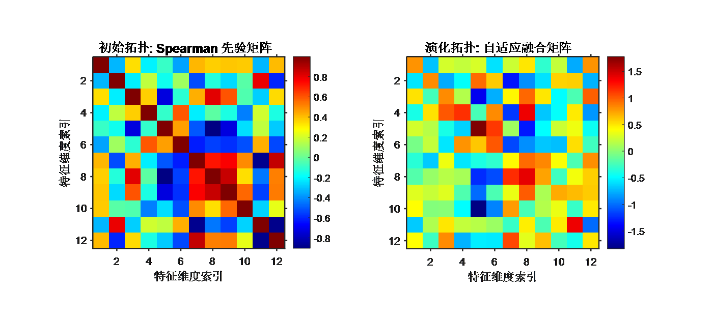
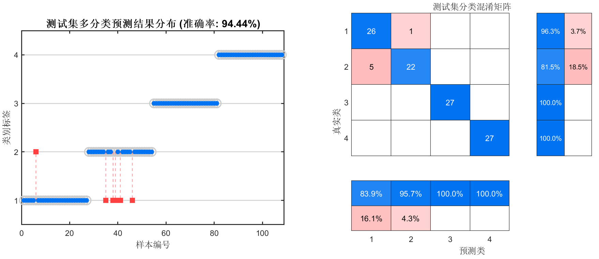
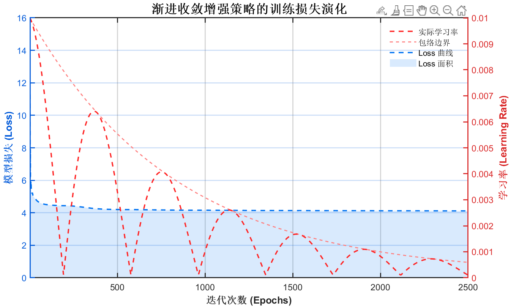

# ResNet+GCN+Progressive Convergence Strategies + Focus Loss, New Breakthrough in Fault Identification! A Program Published in Nature Submission!

Applicable Platform: Matlab2023b and above.
The proposed APRFGC-Net (Adaptive Topology Pruning Focused Residual Graph Convolutional Network) is an original method framework designed for fault identification classification tasks, which can be applied in any field of fault identification.  
This method is not a direct replication of existing literature but rather a systematic integration and targeted improvement based on high-level method ideas such as adaptive graph structure learning, residual graph convolution, focal loss function, and staged learning rate control, combined with the characteristics of fault identification tasks. The method has not yet been written and submitted to a small paper. The model structure corresponding to this program indeed includes core modules such as adaptive graph structure learning, residual enhancement graph convolution, Focal Loss, and progressive convergence enhancement strategies, whose innovation points are determined by who writes first, which is sufficient to support a high-level academic paper. The framework of this article is as follows:
Program Core Thought: Unlike traditional methods that directly input table features into classifiers, this program starts from the fault data itself, constructs a graph of feature relationships, and then conducts graph convolution propagation and classification learning based on this graph. Specifically, the program reads samples from Excel data, completes random shuffling, hierarchical segmentation, and normalization, and uses the training set to calculate a Spearman rank correlation matrix as the initial topological prior; subsequently, an learnable adjacency matrix is introduced to adaptively correct the graph structure, forming a fused topology for classification tasks; on this basis, the residual enhancement graph convolution module is proposed to complete deep feature extraction, and combined with the focal loss function to focus on difficult classification samples, proposing a progressive convergence enhancement optimization strategy, staged optimization of the model's learning rate, achieving accurate recognition of complex fault samples.
The overall structure of APRFGC-Net can be summarized as follows:
Excel Failure Data Input → Hierarchical Division and Normalization → Spearman Prior Topology Construction → Adaptive Graph Structure Learning → ResGCN Deep Feature Extraction → Focus Loss Constraint Training → Gradual Convergence Enhanced Optimization → Failure Classification Output, meaning that with just an Excel formatted data set, this method can be transferred to your research field.
Four major innovations:
2. Residual Enhanced Graph Convolutional Module (ResGCN)
3. In the actual fault classification tasks, there are often instances where some samples are easily distinguishable while others are blurred and difficult to recognize. To address this issue, this paper introduces the focal loss function (Focal Loss) into the program. By assigning higher weights to the hard-to-classify samples, it mitigates the dominance of easy-to-classify samples in overall loss, thereby enhancing the model's focus on complex, boundary, and potential minority class samples. This design aids in improving the robustness and discriminative accuracy of the model in complex multi-classification scenarios.
4. To enhance training stability and later convergence quality, this paper constructs an incremental convergence enhancement optimization strategy. This strategy controls the learning rate change process at different stages, allowing the model to maintain a relatively stable initial start-up process during training, achieve more comprehensive parameter updates in mid-term, and gradually enter a smooth convergence state in the later stage. Compared to fixed learning rates or simple decay methods, this optimization strategy is more conducive to balancing training stability and convergence efficiency, thus improving the overall model performance.
Applicable fields:
This program is suitable for various data classification scenarios based on Excel table features, especially suitable for fault recognition, status diagnosis, and category discrimination tasks. For example:
Fault identification in rolling bearings
Transformer fault diagnosis
Power equipment status classification
Electric power quality disturbance classification
Distribution network equipment fault identification
Transmission line fault area classification
Insulator status recognition
Various industrial process abnormal state classification
...
Simply replace the data with Excel tables and import them directly without making significant modifications to the program. The program includes detailed comments for ease of understanding its operation.
Data format: Each row represents a sample, with the last column being the label of the fault type the sample belongs to.
Program results:
Stay tuned for high-innovation, high-quality learning materials, articles, and code that will support your research efforts!

## Images

<!-- PAYMENT_BLOCK -->

## Get this dataset

- Payment link (Stripe): [Buy now](https://buy.stripe.com/3cs8yP7sY87d0vu9AB)
- Payment QR code: 

<!-- /PAYMENT_BLOCK -->
